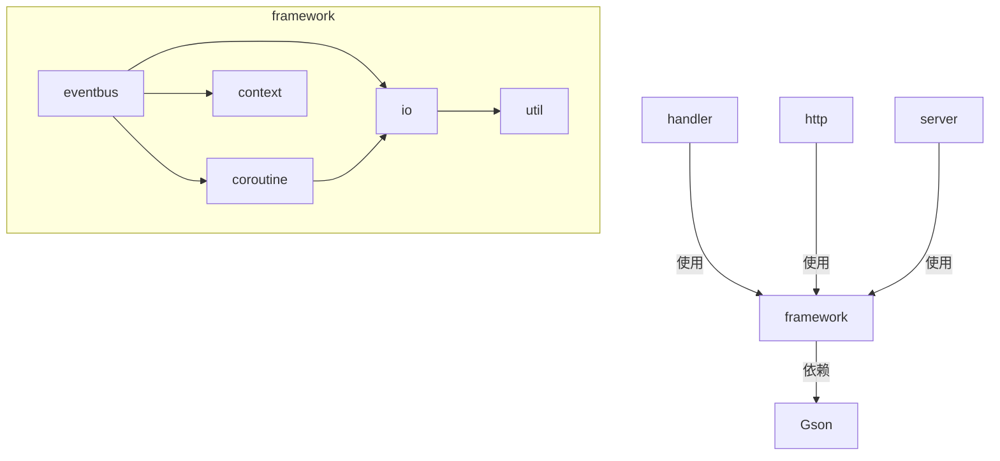

# Architecture Overview

## System Architecture

JavaFramework 是一个模块化 Java 脚手架框架，提供事件驱动、协程调度、IO 封装等基础能力。



## Core Components

### EventBus (com.cxuy.framework.eventbus)

- **LocalEventBus**: 进程内事件总线，基于注解订阅
- **InterProcessEventBus**: 跨进程事件总线，支持服务端/客户端模式
- **协议层**: cross/protocol 定义消息格式（Message, Operation, PostData）

### Coroutine (com.cxuy.framework.coroutine)

- **DispatchQueue**: 协程调度队列
- **DispatcherQueue**: 一次性/循环调度器
- **Task**: 任务抽象，支持 IDLE 任务
- **DispatchGroup**: 任务组，支持批量等待

### IO (com.cxuy.framework.io)

- **KV 存储**: SimpleKV / KVMap / MapStorage / KVProvider
- **文件操作**: FileManager + FileProvider (Read/Write/Extra)

### Context (com.cxuy.framework.context)

- **FrameworkContext**: 框架全局上下文
- **Context**: 通用上下文接口
- **BuildConfig**: 编译期配置

## Data Flow

```
Event Source → EventBus.subscribe() → Handler.invoke()
                                    ↓
                              Coroutine.dispatch()
                                    ↓
                              IO / Network / Compute
```

## Key Design Patterns

- **Observer Pattern**: EventBus + @Subscribe annotation
- **Provider Pattern**: FileProvider / KVProvider 统一接口
- **Strategy Pattern**: DispatcherQueue 的不同实现
- **Singleton**: FrameworkContext 全局单例
